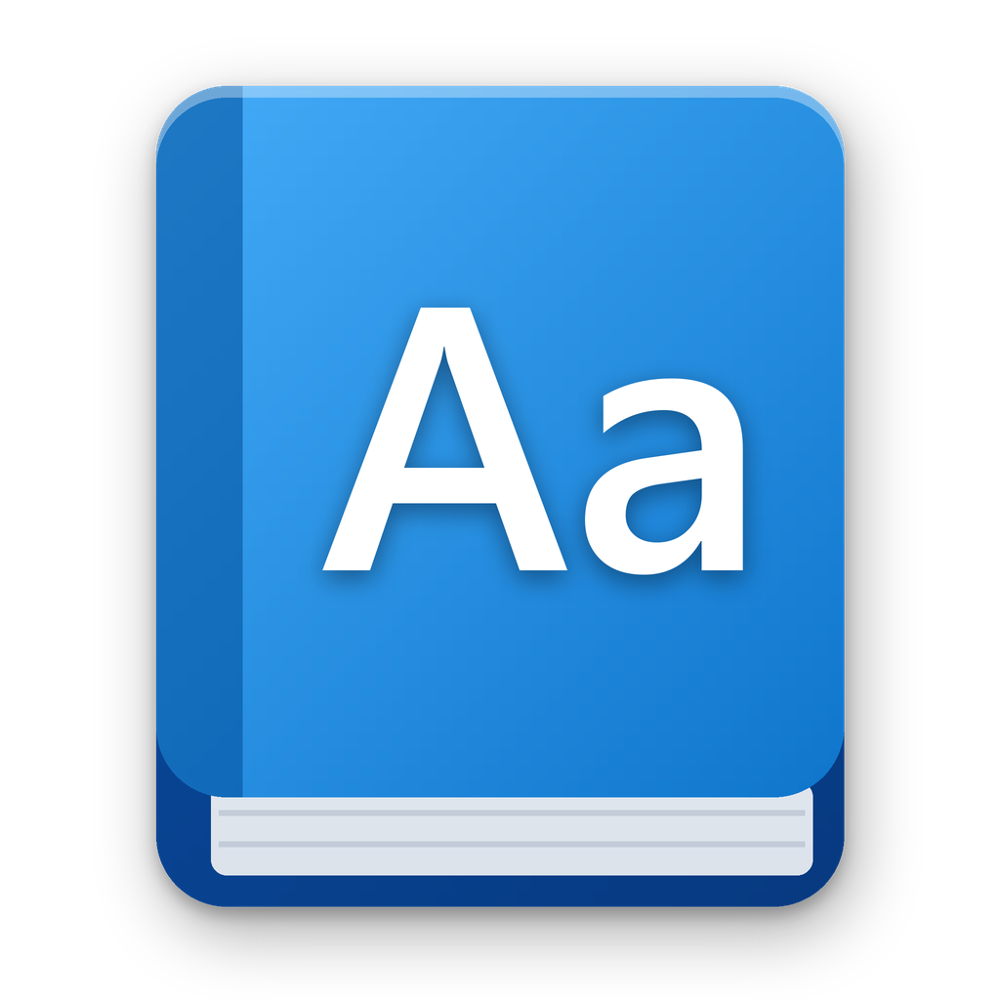
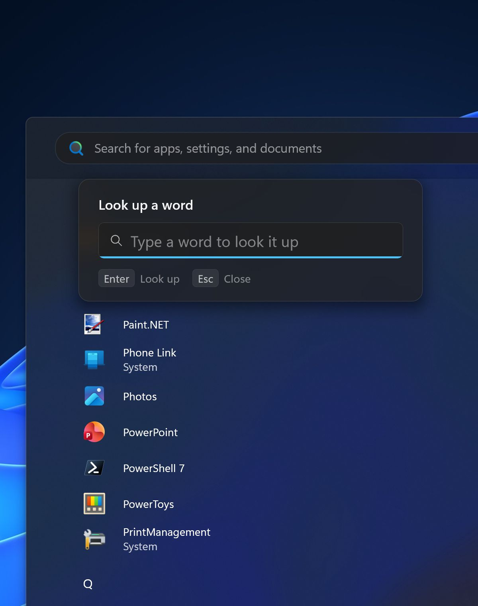
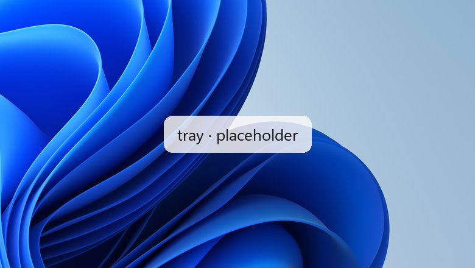

<p align="center">
	
</p>

<h1 align="center">WinDict</h1>

<p align="center">
	Look up and translate any word on Windows, right where you read it.
</p>

<p align="center">
	<a href="https://windict.bosio.zip">windict.bosio.zip</a>
</p>

<p align="center">
	<a href="https://github.com/BosioPietro/WinDict/releases/latest"></a>
	<a href="https://github.com/BosioPietro/WinDict/releases"></a>
	
	
	<a href="LICENSE"></a>
</p>

---

WinDict is a Windows tray app for looking up and translating words. Select a
word in any app and press **Alt+D**: its definition opens in a card next to
the selection. Esc or a click elsewhere closes it.

It's meant to stay out of the way: it uses about 3 MB of memory while idle,
English lookups work offline, and the card follows the system's light or dark
theme and accent color.

<p align="center">
	<a href="https://github.com/BosioPietro/WinDict/releases/latest"></a>
</p>

<p align="center">
	<picture>
		<source media="(prefers-color-scheme: dark)" srcset="assets/intro/lookup-dark.jpg" />
		<source media="(prefers-color-scheme: light)" srcset="assets/intro/lookup-light.jpg" />
		
	</picture>
	&nbsp;
	<picture>
		<source media="(prefers-color-scheme: dark)" srcset="assets/intro/translate-dark.jpg" />
		<source media="(prefers-color-scheme: light)" srcset="assets/intro/translate-light.jpg" />
		
	</picture>
</p>

## Features ✨

- **Definitions in place: select a word, press Alt+D**
- **Translations of a word, a phrase or a whole passage with Alt+T**
- **Works offline for English, with about 150,000 words and phrases built in**
- **Shows above Start and Search, once installed**
- Inflected forms are looked up by their base word ("ran" shows "run")
- Similar and opposite words, each a click away
- Pronunciation in the word's own language, with Windows' own voices
- A box to type into, for text that can't be selected
- `wd`, to look up and translate from the command line
- English, Italian and Spanish dictionaries
- Follows the system's light or dark theme and accent color
- Adjustable text size and shortcuts
- Updates itself from the tray
- About 3 MB of memory while idle, written in Rust against the native Windows APIs

## Looking up words 📖

Inflected forms are looked up by their base word, so selecting "ran" shows
"run". With nothing selected, the shortcut opens a box to type a word into
instead, for text that can't be selected, such as in an image, a protected
PDF or a game.

Under each part of speech the card lists similar words and, where there are
any, opposite ones ("good": "bad"). Clicking one opens its definition in the
same card. To go back, use the arrow next to the word, Backspace, Alt+← or the
mouse's back button.

The speaker button after the word says it out loud, in the word's own
language, with a voice Windows has for it. It shows only when there's one:
voices for more languages can be added in Windows Settings, under Time &
language → Speech.

To make the card's text larger or smaller, press **Ctrl+plus** or
**Ctrl+minus**, or hold Ctrl and turn the mouse wheel over the card. **Ctrl+0**
goes back to the usual size. The settings window follows the same size, and
the same keys work there. The size is kept, and it's also under **Text size**
in the settings.

## Translating 🌐

When online lookup is on, the translate button at the top right of the card,
or **Ctrl+T**, shows a translation of the word instead.

To translate straight away, select a word, a phrase or a whole passage (up to
500 characters) and press **Alt+T**: the card opens on the translation.
For a single word the dictionary has, Back shows its definition.

<details>
<summary>Typing the text to translate</summary>

With nothing selected, **Alt+T** opens a box to type the text to translate
into, with the languages under it, as on the translation card. As you type,
WinDict tells the language from its words, using the dictionaries you've
chosen, and picks the languages:

- with two dictionary languages, from the one you're typing in into the other;
- otherwise, between the default languages in the settings, into the one
  you're not typing in;
- when the language can't be told, the default way.

Click a language to pick another one, or the arrows to swap them; from then
on they stay as you set them. Press Enter to translate; Back on the
translation brings the box back as you left it.

</details>

## On the command line ⌨️

The installer also puts `wd` on the PATH, which looks words up and translates
them in a terminal, printing what the card would show:

```powershell
wd serendipity                   # or: wd define serendipity
wd translate good morning        # or: wd t good morning
wd t buongiorno --to German
Get-Clipboard | wd t
```

It goes by WinDict's settings (dictionaries, languages, what's shown, the
online dictionary), and what's given on the command line goes before them:
`--lang`, `--senses`, `--synonyms` and `--[no-]examples` when looking up,
`--from` and `--to` when translating (a code like `de`, or a name like
`German`), and `--online` or `--offline` for both. `wd help` lists them all.
It exits with 0 for an answer, 1 for none, and 2 for a command it couldn't
make sense of.

## Above the Start menu 🪟

<p align="center">
	<picture>
		<source media="(prefers-color-scheme: dark)" srcset="assets/intro/start-dark.jpg" />
		<source media="(prefers-color-scheme: light)" srcset="assets/intro/start-light.jpg" />
		
	</picture>
</p>

Windows keeps Start and Search above every ordinary window, so by default
WinDict closes them before showing a definition. To have the card appear on
top of them instead, WinDict needs "UI access", which Windows only grants to
signed apps installed in a protected folder.

To turn it on, use the **Show above Start** switch: on the introduction's
**Show the card above Start** step, or in the settings under **General**.
Windows asks for permission, then WinDict restarts with UI access. Turn the
switch off to go back. Only the copy the setup installs can have UI access,
so a downloaded `windict.exe` doesn't show the switch.

<details>
<summary>How it works</summary>

The setup installs a second build of WinDict that asks for UI access, but
leaves it unsigned. The switch runs `uiaccess.ps1`, which creates a
certificate that's trusted on this machine only, signs that build with it
and restarts WinDict. The certificate's private key is deleted right after
signing, so it can't be used to sign anything else. Updates sign the new
version the same way. Turning UI access off removes the certificate, and
uninstalling WinDict does that too.

The script can also be run by hand, from an administrator PowerShell:

```powershell
powershell -ExecutionPolicy Bypass -File "C:\Program Files\WinDict\uiaccess.ps1" -Enable -Restart
```

Use `-Disable -Restart` instead to turn UI access off.

</details>

## How to install 📥

<p align="center">
	<picture>
		<source media="(prefers-color-scheme: dark)" srcset="assets/intro/tray-dark.jpg" />
		<source media="(prefers-color-scheme: light)" srcset="assets/intro/tray-light.jpg" />
		
	</picture>
</p>

### Using the setup (recommended)

1. Download `WinDict-<version>-setup.exe` from the
   [latest release](https://github.com/BosioPietro/WinDict/releases/latest).
2. Run it. It installs WinDict to `C:\Program Files\WinDict`, which it needs to
   show the card above Start, and adds it to Start and to Settings → Apps,
   where it can be uninstalled.

### Without installing

Download `WinDict-<version>.exe` instead and run it from anywhere: it's the
whole app in a single executable.

> [!NOTE]
> The app isn't commercially signed, so the first time Windows SmartScreen may
> ask for confirmation: choose **More info**, then **Run anyway**.

The first time it starts, a short introduction goes through the shortcuts,
each with an example card, and in the installed copy offers to show the
card above Start.

Once it's running, the tray icon's menu has **Start with Windows**,
**Settings…** and **Quit**. When there's a new version, **Update app**
appears there too; the installed copy updates without asking for
permission.

## Settings ⚙️

Open the tray menu and choose **Settings…**. Changes apply right away. To
change a shortcut (the lookup one or the translation one), open **Shortcuts**
under **General**, click the one to change and press the new keys; Esc keeps
the old ones.

The settings are stored in `%APPDATA%\WinDict\config.json`. To edit the file
by hand, use **Open config.json** at the bottom of the settings window, then
**Reload settings** in the tray menu.

## Dictionaries and network use 📚

- English comes from Open English WordNet (about 150,000 words and phrases),
  which is built into the executable. Lookups in it don't use the network and
  take under a millisecond.
- Italian comes from Wikizionario (about 75,000 words), and Spanish from
  Wikcionario (about 135,000). Each is downloaded once, when it's chosen in
  the settings.
- The online dictionary is used for pronunciations and for words the built-in
  one doesn't have. Translations are fetched only when asked for. Both can be
  turned off in the settings.

WinDict uses about 3 MB of memory while idle and around 20 MB while a card is
open.

## Building from source 🛠️

WinDict needs Windows and a Rust toolchain (1.88 or newer).

```powershell
cargo build --release        # target\release\windict.exe
cargo test                   # unit tests, including the bundled dictionary
cargo clippy --all-targets -- -D warnings
```

<details>
<summary>Building the setup</summary>

The installer is built with [Inno Setup](https://jrsoftware.org/isinfo.php) from
both builds, put in `dist`:

```powershell
mkdir dist
cargo build --release
copy target\release\windict.exe dist\WinDict.exe
cargo build --release --features uiaccess
copy target\release\windict.exe dist\WinDict-uiaccess.exe
iscc /DVersion=0.26.0 installer\windict.iss   # dist\WinDict-v0.26.0-inno.exe
```

The setup that's published carries that installer and runs it silently, from
a window of its own (`src/setup.rs`) or, given Inno Setup's switches as WinGet
and "Update app" give them, without one. It's built with the installer's
absolute path in `WINDICT_SETUP`:

```powershell
$env:WINDICT_SETUP = (Resolve-Path dist\WinDict-v0.26.0-inno.exe).Path
cargo build --release --features setup --bin windict-setup   # target\release\windict-setup.exe
```

</details>

## Credits 🙌

- English definitions: [Open English WordNet](https://en-word.net/)
  (CC BY 4.0, derived from Princeton WordNet; see `data/LICENSE-WordNet.txt`).
- Online English lookups: [Wiktionary](https://www.wiktionary.org/), through
  [dictionaryapi.dev](https://dictionaryapi.dev), falling back to Wiktionary
  directly.
- Italian dictionary and online lookups:
  [Wikizionario](https://it.wiktionary.org/), through
  [wiktextract](https://kaikki.org/itwiktionary/), falling back to
  Wikizionario's own API (CC BY-SA 4.0; see `data/LICENSE-Wiktionary.txt`).
- Spanish dictionary and online lookups:
  [Wikcionario](https://es.wiktionary.org/), through
  [wiktextract](https://kaikki.org/eswiktionary/) (CC BY-SA 4.0).
- Translations: Google Translate's public web endpoint, which is unofficial
  and may change, falling back to [MyMemory](https://mymemory.translated.net/).

WinDict is [MIT licensed](LICENSE).
